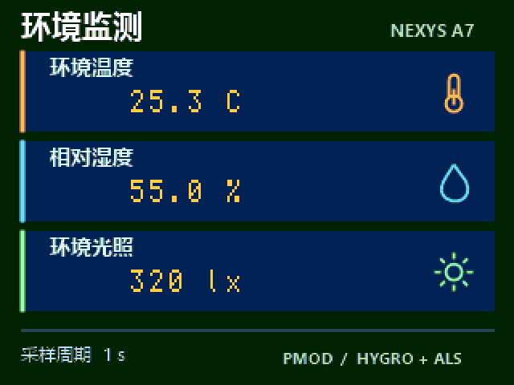

# Nexys A7 环境监测仪表盘

打开 `env_vga_tf.xpr`，顶层为 `env_vga_tf_top`，目标器件为 `xc7a100tcsg324-1`。采集、FAT32 读写、BMP 解码、VGA 叠字和日志队列均由 FPGA 上的 Verilog 电路运行。PC 端 Python 工具仅用于备卡和导出记录。

## 上板

1. 使用已有 FAT32 文件系统的 SDHC 或 SDXC microSD 卡，逻辑扇区为 512 字节。支持 MBR 中的主 FAT32 分区或直接从扇区 0 开始的 FAT32 卷。常见的 4 至 32 GB FAT32 卡适合首次验证。SDXC 卡出厂常用 exFAT，需要选用已有 FAT32 格式的卡。
2. 对一张新准备的卡，将 `tf_card` 里的 **IMAGES** 和 **LOGS** 两个文件夹复制到卡根目录。已有记录的卡建议使用下面的 `prepare` 命令，原日志会保留。若 Windows 提示覆盖已有 `ENVLOG.BIN`，覆盖会清空那些记录。
3. Pmod HYGRO 接 **JB**，启用其 I²C 上拉；Pmod ALS 接 **JC**，显示器接板载 VGA。插入 TF 卡，在 Vivado Hardware Manager 中通过 JTAG 下载 `bitstream/env_vga_tf.bit`。样例卡用于背景和日志，FPGA 由 JTAG 或已有配置存储器配置。
4. 卡初始化后，板子读取 BMP 并缓存底图。传感器每秒采样一次。读数无效或过期的通道显示横线，报警等级达到 2 时数字使用报警色。无卡时仍可在默认底色上查看读数。

卡根目录结构如下。

```text
IMAGES/
    BG.BMP          320 × 240，24 位，未压缩 Windows BMP
LOGS/
    ENVLOG.BIN      事先分配的日志文件（样例为 16 MiB）
```

工程附带的卡模板以这两个固定的 8.3 文件名工作。电路沿 FAT 簇链访问目录和文件，支持碎片文件。TF 卡控制器使用 SPI 模式，初始化时约 391 kHz，完成初始化后为 6.25 MHz。

## 更换底图

将自定义图片导出为 **320×240、24 位、BI_RGB 无压缩的 BMP**，保存为 `IMAGES/BG.BMP`。支持像素行自底向上或自顶向下排列。启动时 FPGA 将 BGR 像素转换成 RGB332，存入 75 KiB 双口 BRAM，VGA 在 640×480 画面中放大两倍。每个读数独立叠加，底图可以放中文标题、图标、边框。

| 数据行 | VGA 上预留的像素矩形（含单位） | 原始 BMP 上相应的矩形 |
|---|---|---|
| 温度 | x=64…303，y=112…143 | x=32…151，y=56…71 |
| 相对湿度 | x=64…303，y=224…255 | x=32…151，y=112…127 |
| 光照 | x=64…303，y=336…367 | x=32…151，y=168…183 |



## 记录和导出

在工程目录运行下面的命令。示例中的 `F:/` 应换成实际卡盘符。`prepare` 只写命名目录内的普通文件，不格式化磁盘，也不会清除现有日志。默认预留 16 MiB，可用 `--mib 64` 等参数在新卡上调整容量。导出命令的 CSV 目标须是新文件。

```powershell
python tools/card_tool.py prepare F:/
python tools/card_tool.py export F:/LOGS/ENVLOG.BIN readings.csv
```

每秒的报警判定节拍锁存温度、湿度、照度、光照 ADC、状态和上电秒数。下一个 100 MHz 时钟周期配上对应的报警等级和来源，先进入 32 条 FIFO，再写卡。每条记录占一个 512 字节扇区。样例可记录 **32,768 条，约 9 小时 6 分钟**。写满后停止，板上显示仍继续。重新插卡或复位后沿文件查找下一个空槽，已写的扇区和断电留下的非空残块都会跳过。上电秒数每次系统复位从头计算，CSV 的 `slot` 表示文件中的先后顺序。

导出工具验证每条记录的标志和 CRC，并报告损坏、空闲扇区数量。掉电或拔卡时，仍在 FIFO 或在途的采样可能丢失。切换到电脑前建议先关闭开发板。文件的目录长度始终等于预分配容量，不能依据其大小判断已经记录多久。

| 记录字段 | 扇区内字节 | 编码 |
|---|---|---|
| 标志 | 0…3 | ASCII `ENV1` |
| 上电秒、温度、湿度、光照 | 4…13 | 32 位无符号秒、16 位有符号 0.1 °C、16 位无符号 0.1 %RH、16 位 lx，全为小端 |
| 传感器状态、报警等级、来源、data_ok | 14…17 | 各占一字节 |
| ALS 原始 ADC | 18…19 | 16 位小端，低 12 位使用 |
| CRC、结束标志 | 508…511 | 前 20 字节的 CRC-16/CCITT-FALSE，小端；最后两字节为 A5 5A |

状态位 0、1 分别表示温湿度和光照通信正常，位 2、3 表示对应通道过期。`0x03` 表示两路均正常。光照单位为 lx，换算表沿用原工程的名义估算。

## 状态灯

| LED | 点亮的含义 |
|---|---|
| 15 | SD 初始化或文件系统错误、图片缺失或 BMP 格式错误 |
| 14 | 日志文件已满 |
| 13 | 日志队列曾溢出，本次插卡期间有记录未进入队列 |
| 12 | 已定位日志文件并完成初始扫描 |
| 11 | 已完整加载有效背景 |
| 10、9 | SD 卡 SPI 初始化完成、卡已检测到 |
| 8、7…4、3…0 | 原有蜂鸣许可、报警来源、报警等级 |

## 重建与仿真

Vivado 2026.1 的命令行可直接打开本目录重建。

```text
vivado -mode batch -source scripts/project.tcl -tclargs build
python scripts/run_tests.py
```

仿真命令需要 Icarus Verilog，支持 `--bin` 指定程序目录和 `--libdir` 指定便携版后端目录。七组仿真覆盖原传感器及报警、SD SPI 读写、FAT32 簇链、BMP 正反行序、VGA 叠字、SPI 重启续写，以及从交付 BMP 到 VGA 和日志的联合通路。时序和资源见 `reports/`。实物卡与显示器的兼容性仍需在目标板验证。
